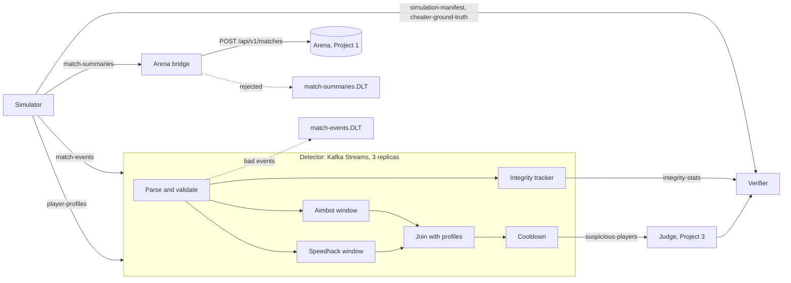

# Fairplay Telemetry

[](https://github.com/ArghadeepMisra/gamer-simulation/actions/workflows/ci.yml)

Real-time cheat detection on Kafka Streams. A simulator streams about 25,000 gameplay events per second for 1,000 fake players (5% of them cheating) into Kafka. A three-instance Kafka Streams detector flags aimbots and speedhacks within seconds, and a verifier scores the flags against ground truth and proves that no event was lost or duplicated, even after one detector is killed mid-run.

Telemetry is Project 2 of **Fairplay**: Arena (Project 1) is the game platform, Telemetry produces the evidence, and the Judge (Project 3) reads the flags on `suspicious-players` and decides what to do about them. Every number in [Results](#results) was measured on the machine described there, including the ones that miss their targets.

## What it does

- **Detects cheating from raw events.** Two rules run over 5-second hopping windows that advance every second: an aimbot rule (fast reactions plus a high headshot rate) and a speedhack rule (too many movement samples over the speed limit).
- **Publishes flags to a topic.** Each flag on `suspicious-players` carries a score between 0.5 and 1.0 and the evidence behind it. A per-player, per-rule cooldown keeps one cheater from flooding the topic.
- **Proves exactly-once processing.** The topology counts every event's sequence number per player and publishes the totals (count, duplicates, gaps) to `integrity-stats`. The verifier compares them with the simulator's manifest of what it sent.
- **Survives bad input.** Malformed bytes, invalid events and events whose key does not match their player go to a dead-letter topic instead of crashing the stream.
- **Forwards finished matches to Arena (optional).** A Kafka listener posts each `match-summaries` record to Arena's `POST /api/v1/matches`, retrying temporary failures with exponential backoff and dead-lettering permanent ones. It is off by default.

## Architecture



The detector reads `match-events` as raw bytes and parses them inside the topology, so a corrupt record is routed to the dead-letter topic rather than killing the stream thread. The window branches re-parse the raw stream with `mapValues` instead of reusing the parse step's output. `KStream#process` marks its output as possibly key-changing, and Kafka Streams would then add a repartition topic per window and push every event through the broker a second time. A topology test and a broker test both guard against that.

Flags from both rules are merged and repartitioned by player, left-joined to the `player-profiles` table to add the username and skill tier, then de-duplicated by the cooldown before they are written out.

### Topics

Keys are player ids (strings) and values are UTF-8 JSON. Player-keyed topics have 6 partitions, so the join is co-partitioned.

| Topic | Partitions | Cleanup | Purpose |
| --- | --- | --- | --- |
| `match-events` | 6 | delete, 24 h | Shots, positions and kills from the simulator |
| `match-events.DLT` | 6 | delete, 7 d | Events the detector could not parse or validate |
| `player-profiles` | 6 | compact | Username and skill tier per player |
| `suspicious-players` | 6 | delete, 7 d | Detector output: one flag per rule hit (the contract with the Judge) |
| `integrity-stats` | 6 | compact | Per-player count, duplicates and gaps |
| `match-summaries` | 3 | delete, 7 d | Finished match results, shaped like Arena's request body |
| `match-summaries.DLT` | 3 | delete, 7 d | Summaries Arena rejected or that could not be parsed |
| `cheater-ground-truth` | 1 | compact | Who really cheats; read by the verifier only, never by the detector |
| `simulation-manifest` | 1 | compact | What the simulator sent, for the integrity check |

Consumers of `suspicious-players` and `integrity-stats` must read with `isolation.level=read_committed`, because the detector writes inside Kafka transactions.

### Detection rules

Boundaries are inclusive. The values below are the defaults in `telemetry-detector/src/main/resources/application.yml` and can all be overridden.

| Rule | Fires when, in one 5 s window |
| --- | --- |
| Aimbot | at least 12 hits, average reaction time at most 140 ms, and headshot rate at least 0.62 |
| Speedhack | at least 40 moving samples, and at least 15% of them over the speed limit of 7.5 |

A flag's score runs from 0.5 (just over the line) to 1.0 (far over it). The formulas are in `DetectionRules`.

## Quick start

You need Java 21 and Docker. The Maven wrapper downloads Maven itself. On Windows, use `.\mvnw.cmd` in PowerShell or `./mvnw` in Git Bash.

```bash
cp .env.example .env
docker compose up -d --build                             # broker, Kafka UI, 3 detectors, Prometheus, Grafana
docker compose --profile sim up -d telemetry-simulator   # starts the 5-minute run
docker compose logs -f telemetry-simulator               # wait for SIMULATION COMPLETE
docker compose --profile tools run --rm telemetry-verifier --mode=detection --min-recall=0.98 --max-fpr=0.01
docker compose --profile tools run --rm telemetry-verifier --mode=integrity --settle=60s
```

Reports are written to `reports/`. Player ids repeat for a given seed, so run `docker compose --profile sim --profile tools down -v` before every measured run.

- Kafka UI: <http://localhost:8090>
- Grafana (dashboard "Fairplay Telemetry", login admin/admin): <http://localhost:3000>
- Prometheus: <http://localhost:9090>

`scripts/measured-run.sh` does a whole measured run (fresh stack, simulation, a chaos kill about 90 s in, both verifier modes). `scripts/chaos-kill.sh` kills one detector replica, prints how long the survivors took to settle, and shows that all 6 `match-events` partitions are owned again.

To change the processing guarantee for the comparison run, set `PROCESSING_GUARANTEE=at_least_once` in `.env` before starting the stack. `docker compose down -v` does not remove services behind a profile, so always name them: `docker compose --profile sim --profile tools down -v`.

### Build and test

```bash
./mvnw verify      # all unit and integration tests, plus the 85% line-coverage gate per module (needs Docker)
./mvnw test        # unit tests only, no Docker needed
./mvnw -pl telemetry-detector -am test -Dtest=AimbotTopologyTest -Dsurefire.failIfNoSpecifiedTests=false
```

### Configuration

`.env.example` lists every setting with its default. The ones you are most likely to change:

| Variable | Default | Meaning |
| --- | --- | --- |
| `KAFKA_BOOTSTRAP` | `localhost:9092` | Broker address (containers use `kafka:19092`) |
| `SIM_SEED` | `42` | Seed for the population and each player's behavior |
| `SIM_PLAYERS` | `1000` | Simulated players (must be a multiple of match size times shard threads) |
| `SIM_DURATION` | `5m` | How long a run lasts (must exceed the 60 s latest cheat start) |
| `PROCESSING_GUARANTEE` | `exactly_once_v2` | `at_least_once` for the integrity comparison |
| `ARENA_ENABLED` | `false` | Register the players in Arena and forward finished matches to it |
| `TELEMETRY_SERVICE_PASSWORD` | none | Password of Arena's `telemetry-sim` service account; startup fails if it is blank while Arena is enabled |

Invalid settings fail at startup with a message naming the property.

### Using Arena

With Arena (Project 1) running, set `ARENA_ENABLED=true`, `ARENA_BASE_URL` and `TELEMETRY_SERVICE_PASSWORD`. The simulator registers its 1,000 players through Arena's API (on virtual threads, remembering the ids in `sim-players.json`) before the run starts, and uses Arena's ids for everything it sends. The detector's bridge then posts each finished match. Replays are safe because Arena treats the match's `externalId` as idempotent.

Once the Judge bans cheaters, Arena answers `422 PLAYER_NOT_ELIGIBLE` for matches that include them, and those summaries land in `match-summaries.DLT`. That is expected behavior, not a bug.

## Design decisions

- **Parse inside the topology, not in a deserializer.** A deserialization exception handler can only skip or fail. Parsing in a processor lets one record be routed to `match-events.DLT` with its offset, Base64 payload and the reason, while the stream carries on.
- **5-second hopping windows, advancing every second.** A 5 s window is long enough to hold 12 or more shots and 40 or more movement samples, and a 1 s advance means a cheater is flagged within about a second of crossing the threshold. Wider windows would make detection slower, narrower ones noisier.
- **Per-player sequence numbers as the exactly-once proof.** Every event carries a per-player `seq` (1, 2, 3, ...) and the simulator records its final value. If the detector's count for a player equals that final value with zero duplicates and zero gaps, nothing was lost and nothing was processed twice. This is a stronger check than comparing totals.
- **Standby replicas and a 6-second session timeout.** `num.standby.replicas=1` keeps a warm copy of every state store on another instance, and `session.timeout.ms=6000` (the broker minimum) lets the group notice a killed instance in about 6 s instead of the default 45 s.
- **A cooldown store.** A hopping window keeps matching for as long as a cheater cheats, so the same player would be flagged every second. A store keyed by `playerId|rule` drops repeats for 10 minutes, and an aimbot flag never hides a speedhack flag.
- **Ground truth is kept away from the detector.** The simulator writes who really cheats to its own topic, which only the verifier reads. A topology test fails if the detector's topology ever lists that topic as a source, so the evaluation stays honest.

## Results

Measured on one machine, with one run per configuration. No result was tuned after the fact.

**Machine:** AMD Ryzen 5 3600 (6 cores, 12 threads), 16 GB RAM, Windows 11, Docker Desktop on WSL2 (VM with 12 CPUs and 7.7 GB). The broker, UI, Prometheus and Grafana ran with no memory cap; each detector replica and the simulator were capped at 1 GB. Everything ran on that one machine, including the load generator.

**Run:** 1,000 players, 5 minutes, seed 42, 3 detector replicas, one replica killed about 90 s in with `docker kill`.

### Benchmark table

| Claim | Target | Measured (`exactly_once_v2`) | Met? |
| --- | --- | --- | --- |
| Events per second | 25,000 | About 24,900/s produced, steady for the whole 5 minutes (24,556 to 25,204 in every 10 s window); about 25,000/s processed | yes, for the rate. **Lag did not stay flat** (see below) |
| `match-events` partitions, keyed by player id | 6 | 6 | yes |
| Median detection latency, obvious cheaters | under 5 s | `AIMBOT` 3.9 s, `SPEEDHACK` 0.9 s | yes |
| Cheaters caught (recall) | at least 98% | 100% (50 of 50) | yes |
| False-positive rate | under 1% | 0.11% (1 of 950 honest and pro players) | yes |
| Lost or duplicated events after killing 1 of 3 detectors | 0 and 0 | 0 and 0 (7,466,329 expected, 7,466,329 counted, all 1,000 players pass) | yes |
| Failover | under 10 s | 14.4 s (16.7 s and 14.5 s in the two at-least-once runs) | **no** |
| Test coverage | at least 85% per module | 100% common, 99.2% simulator, 100% detector, 100% verifier | yes |

### Detection

| Cheat type | Cheaters | Detected | p50 | p95 | max |
| --- | --- | --- | --- | --- | --- |
| `AIMBOT` | 20 | 20 | 3.9 s | 7.6 s | 10.9 s |
| `AIMBOT_SUBTLE` | 10 | 10 | 6.6 s | 21.4 s | 21.4 s |
| `SPEEDHACK` | 12 | 12 | 0.9 s | 2.5 s | 2.5 s |
| `SPEEDHACK_SUBTLE` | 8 | 8 | 2.0 s | 5.7 s | 5.7 s |
| **All** | 50 | 50 | 3.0 s | 17.6 s | 21.4 s |

Latency is the time from the moment a cheater's cheat starts to the first flag. All 50 flags used the correct rule, and no cheater was flagged before cheating. The one false positive is `sim_0815`, a PRO player (an honest but genuinely excellent one) flagged by the aimbot rule with a score of 0.538 (12 hits, headshot rate 0.667, average reaction 139 ms). That is exactly the kind of borderline case the Judge is meant to clear, and 1 of 20 pros is 5% while 0 of 930 ordinary players were flagged.

### Exactly-once, and the at-least-once comparison

Same run, same seed, same kill, only `PROCESSING_GUARANTEE` changed.

| | `exactly_once_v2` | `at_least_once` |
| --- | --- | --- |
| Run id | `r-49fe8f` | `r-df576c` (and `r-8bfb5e`, see below) |
| Events expected (sum of `finalSeq`) | 7,466,329 | 7,465,795 (7,467,529) |
| Events counted | 7,466,329 | 7,465,795 (7,467,529) |
| Duplicates | 0 | 0 (0) |
| Gaps | 0 | 0 (0) |
| Players passing | 1,000 of 1,000 | 1,000 of 1,000 (1,000 of 1,000) |
| Failover | 14.4 s | 16.7 s (14.5 s) |
| Integrity exit code | 0 | 0 (0) |

**This comparison did not show what I expected.** The plan was that the at-least-once run would count duplicates after the kill, because a state-store write can reach the changelog before the matching offset commit, so a new owner would replay events the store had already seen. It showed none. I checked that the detectors really ran `at_least_once` (the logged Streams configuration says so). Because the spec says to try harder when that happens, I ran it a second time with the state-store cache switched off (`statestore.cache.max.bytes=0`, the figures in parentheses), which is the condition under which that window should be widest. It also showed 0 duplicates and 0 gaps.

So what these runs establish is narrower than the original plan: the exactly-once run lost and duplicated nothing across a mid-run kill, and the checker would have caught it otherwise (`ExactlyOnceIT` re-sends one event and expects exactly one duplicate). They do **not** show exactly-once beating at-least-once. I did not find out why at-least-once stayed clean. A likely reason is that a duplicate needs the instance to die inside the short gap between a changelog write and the offset commit, and `docker kill` in one run did not land there, but I have not verified that. One side effect did show up: with the cache off, the detector wrote every update to its changelog and fell behind, and the median detection latency rose from about 3 s to about 30 s.

### Throughput and the failover

- The simulator logged 24,556 to 25,204 events/s in every 10-second window for the whole run (7,466,329 acknowledged, 0 failed sends, 7,503 malformed records injected).
- Grafana and Prometheus over minutes 2 to 4 of the exactly-once run: events produced averaged 24,886/s and events processed 25,647/s. That window contains the failover, so the processed rate rises above the produced rate while the survivors catch up.
- **Lag did not stay flat, and the failover missed its target.** With one third of the consumers gone the survivors fell behind by about 14 s of input, and consumer lag (per-partition maximum) peaked near 380,000 events. Two instances have only about 5,000 events/s of headroom over the 25,000/s input here, so draining that backlog took roughly 2 minutes. Before the kill, the per-partition maximum lag sat between 15,000 and 20,000, above the roughly 12,500 the spec expects. The consumer group's lag was 0 once the run ended and the detectors caught up.
- The 14.4 s failover has a clear timeline from the survivors' logs: the group noticed the dead member about 5 s after the kill (the session timeout), then Kafka Streams ran three rebalances back to back (task migration is done in steps, and each step triggers a follow-up rebalance) before both survivors were `RUNNING` again. The 6 s session timeout is therefore not the only cost: expect roughly 5 to 6 s of detection plus 8 to 9 s of rebalancing in this setup. The consumer group showed all 6 `match-events` partitions owned by the two survivors afterwards.

## Tech stack

Java 21, Spring Boot 4.1.2, Apache Kafka and Kafka Streams 4.2.2 (KRaft, no ZooKeeper), Jackson 3, Micrometer with Prometheus output, Maven multi-module build, JUnit 5, Testcontainers, JaCoCo, Docker Compose, Prometheus and Grafana.

## Modules

| Module | What is in it |
| --- | --- |
| `telemetry-common` | Event and result records, the JSON serde, topic definitions, and a test-jar of shared helpers (fixed clock, event builders, Kafka test container, a stub Arena server) |
| `telemetry-simulator` | Seeded player population and cheater assignment, behavior profiles, event generation, match accounting, malformed-record injection, the shard workers and run loop, the Kafka publisher, the manifest, and Arena player registration |
| `telemetry-detector` | The Kafka Streams topology (plain Java, no Spring), the Spring Boot app around it (metrics, health indicator, runtime config), and the optional Arena bridge |
| `telemetry-verifier` | A one-shot command-line app: scores detection against ground truth, checks integrity totals against the manifest, writes Markdown reports and exits with a status code |

The simulator is seeded, so the same seed produces the same players, the same cheaters and the same behavior. Match boundaries follow the wall clock, so a whole run is not bit-for-bit repeatable.

## Testing

Tests come in three layers:

1. **Unit tests** for the pure logic: detection rules, window statistics, the event validator, property validation, the seeded simulator parts, the verifier's math.
2. **`TopologyTestDriver` tests** that run the whole detector topology in memory with a controllable clock. There is no Spring and no broker, so window, join and cooldown behavior can be tested at exact timestamps.
3. **Integration tests** (`*IT`) that start `apache/kafka-native` through Testcontainers: the simulator end to end, the detector end to end, the exactly-once check with a negative control, the verifier's topic reader, and the Arena bridge's retry and dead-letter behavior against a stub Arena.

Last full `./mvnw verify` (2026-11-19): **269 unit tests and 17 integration tests, all passing.** Line coverage is 100% in `telemetry-common`, 99.2% in `telemetry-simulator`, 100% in `telemetry-detector` and 100% in `telemetry-verifier` (the build fails below 85% per module). Coverage only says a line ran: for example every verifier unit test passed while the verifier could not start inside Spring, which is why `VerifierContextTest` now starts the whole application context.

## What I would do next

- **Avro with Schema Registry** for `MatchEvent`, with a demonstrated backward-compatible change.
- **Kafka 4.2's native Kafka Streams dead-letter queue support**, in place of routing bad records by hand.
- **Per-tier thresholds**, so a PRO player is judged against other pros and the one false positive above disappears.
- **A second broker with replication factor 3**, so a broker failure can be tested the way a detector failure is.
- **Faster failover.** The three back-to-back rebalances are the largest cost after the session timeout. Tuning warm-up and probing settings, or trying the new Kafka Streams rebalance protocol, are the first things to try.
