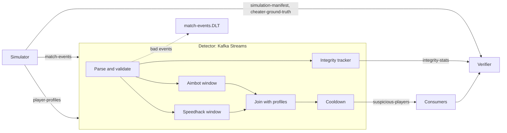

# Fairplay Telemetry

Real-time cheat detection on Kafka Streams. A simulator streams gameplay events for a thousand fake players (5% of them cheating) into Kafka. A stream processor flags aimbots and speedhacks within seconds, and a verifier scores the flags against ground truth and checks that no event was lost or duplicated.

**Status: work in progress.** The shared contracts, the simulator's core logic and the complete detector are built and tested. The simulator's run loop, the verifier and the full Docker Compose stack are not. See [Status](#status) for the exact split.

## What it does

- **Detects cheating from raw events.** Two rules run over 5-second hopping windows that advance every second: an aimbot rule (fast reactions plus a high headshot rate) and a speedhack rule (too many movement samples over the speed limit).
- **Publishes flags to a topic.** Each flag on `suspicious-players` carries a score between 0.5 and 1.0 and the evidence behind it. A per-player, per-rule cooldown keeps one cheater from flooding the topic.
- **Proves exactly-once processing.** The topology counts every event's sequence number per player and publishes the totals (count, duplicates, gaps) to `integrity-stats`. The verifier will compare them with the simulator's manifest of what it sent.
- **Survives bad input.** Malformed bytes, invalid events and events whose key doesn't match their player go to a dead-letter topic instead of crashing the stream.

## Architecture



The detector reads `match-events` as raw bytes and parses them inside the topology, so a corrupt record is routed to the dead-letter topic rather than killing the stream thread. The window branches re-parse the raw stream with `mapValues` instead of reusing the parse step's output. `KStream#process` marks its output as possibly key-changing, and Kafka Streams would then add a repartition topic per window and push every event through the broker a second time. A topology test and a broker test both guard against that.

Flags from both rules are merged and repartitioned by player, left-joined to the `player-profiles` table to add the username and skill tier, then de-duplicated by the cooldown before they are written out.

### Topics

Keys are player ids (strings) and values are UTF-8 JSON. Player-keyed topics have 6 partitions, so the join is co-partitioned.

| Topic | Partitions | Purpose |
| --- | --- | --- |
| `match-events` | 6 | Shots, positions and kills from the simulator |
| `match-events.DLT` | 6 | Events the detector could not parse or validate |
| `player-profiles` | 6 (compacted) | Username and skill tier per player |
| `suspicious-players` | 6 | Detector output: one flag per rule hit |
| `integrity-stats` | 6 (compacted) | Per-player count, duplicates and gaps |
| `match-summaries` | 3 | Finished match results |
| `match-summaries.DLT` | 3 | Summaries that could not be forwarded |
| `cheater-ground-truth` | 1 (compacted) | Who really cheats; read by the verifier only |
| `simulation-manifest` | 1 (compacted) | What the simulator sent, for the integrity check |

Consumers of `suspicious-players` and `integrity-stats` should read with `isolation.level=read_committed`, because the detector writes inside Kafka transactions.

### Detection rules

Boundaries are inclusive. The values below are the defaults in `telemetry-detector/src/main/resources/application.yml` and can all be overridden.

| Rule | Fires when, in one 5 s window |
| --- | --- |
| Aimbot | at least 12 hits, average reaction time at most 140 ms, and headshot rate at least 0.62 |
| Speedhack | at least 40 moving samples, and at least 15% of them over the speed limit of 7.5 |

A flag's score runs from 0.5 (just over the line) to 1.0 (far over it). The formulas are in `DetectionRules`.

## Tech stack

Java 21, Spring Boot 4.1.2, Apache Kafka and Kafka Streams 4.2.2 (KRaft, no ZooKeeper), Jackson 3, Micrometer with Prometheus output, Maven multi-module build, JUnit 5, Testcontainers, JaCoCo.

The detector runs with `exactly_once_v2`, one standby replica per state store, and a 6 s session timeout so a failed instance's partitions are reassigned quickly.

## Modules

| Module | What is in it |
| --- | --- |
| `telemetry-common` | Event and result records, the JSON serde, topic definitions, and a test-jar of shared helpers (fixed clock, event builders, Kafka test container) |
| `telemetry-simulator` | Seeded player population and cheater assignment, behavior profiles, event generation, match accounting, malformed-record injection |
| `telemetry-detector` | The Kafka Streams topology (plain Java, no Spring) and the Spring Boot app around it: metrics, health indicator, runtime config |
| `telemetry-verifier` | Scores detection against ground truth and checks the integrity totals (not built yet) |

The simulator is seeded, so the same seed produces the same players, the same cheaters and the same behavior. Match boundaries follow the wall clock, so a whole run is not bit-for-bit repeatable.

## Getting started

You need Java 21 and Docker. The Maven wrapper downloads Maven itself.

```bash
cp .env.example .env
docker compose up -d        # Kafka broker on :9092 and Kafka UI on http://localhost:8090
```

On Windows, use `.\mvnw.cmd` instead of `./mvnw`.

Build and run the unit tests (no Docker needed):

```bash
./mvnw test
```

Build and run everything, including the integration tests that start a real Kafka broker in Docker:

```bash
./mvnw verify
```

`verify` also enforces at least 85% line coverage per module. A single test class:

```bash
./mvnw -pl telemetry-detector -am test -Dtest=AimbotTopologyTest -Dsurefire.failIfNoSpecifiedTests=false
```

Package the detector and start it against the local broker:

```bash
./mvnw -pl telemetry-detector -am package -DskipTests
java -jar telemetry-detector/target/telemetry-detector-0.0.1-SNAPSHOT.jar
```

Its health and metrics are on `http://localhost:8082/actuator/health` and `/actuator/prometheus`. Nothing writes to `match-events` yet, so for now events come from the tests. Run `docker compose down -v` to stop the stack and wipe its data.

### Configuration

`.env.example` lists every setting with its default. The ones you are most likely to change:

| Variable | Default | Meaning |
| --- | --- | --- |
| `KAFKA_BOOTSTRAP` | `localhost:9092` | Broker address |
| `SIM_SEED` | `42` | Seed for the population and each player's behavior |
| `SIM_PLAYERS` | `1000` | Simulated players (must be a multiple of match size times shard threads) |
| `SIM_DURATION` | `5m` | How long a run lasts |
| `PROCESSING_GUARANTEE` | `exactly_once_v2` | Set to `at_least_once` to compare integrity results |
| `ARENA_ENABLED` | `false` | Turn on forwarding of match summaries to an external matches API |

Invalid settings fail at startup with a message naming the property. For example, an empty `TELEMETRY_SERVICE_PASSWORD` is rejected when `ARENA_ENABLED=true`.

## Testing

Tests come in three layers:

1. **Unit tests** for the pure logic: detection rules, window statistics, the event validator, property validation, the seeded simulator parts.
2. **`TopologyTestDriver` tests** that run the whole detector topology in memory with a controllable clock. There is no Spring and no broker, so window, join and cooldown behavior can be tested at exact timestamps.
3. **Integration tests** (`*IT`) that start `apache/kafka-native` through Testcontainers and run the detector end to end, including the exactly-once check.

## Status

| Area | State |
| --- | --- |
| Maven build, JaCoCo coverage gate, local broker and Kafka UI | Done |
| `telemetry-common` (records, serde, topics, test helpers) | Done |
| Simulator core (population, cheaters, behavior, event factory, match summaries, malformed injection) | Done |
| Detector (parse and dead-letter, integrity, both rules, profile join, cooldown, Spring wiring, metrics, health) | Done, tested against a real broker |
| Simulator run loop and Kafka publisher, manifest and ground-truth writers | Not started |
| Match-summary bridge to an external matches API | Not started (off by default) |
| Verifier (`detection` and `integrity` modes) | Not started |
| Docker Compose with three detector replicas, Prometheus, Grafana | Not started |
| Measured benchmarks | Not run yet |

Until the run loop exists there is no live end-to-end demo, so the README has no benchmark numbers on purpose. These are the design targets the finished system will be measured against, and they are not results:

- about 25,000 events per second from 1,000 players
- recall of at least 0.98 and a false-positive rate of at most 0.01 against ground truth
- recovery from killing one detector instance in under 10 seconds
- zero lost or duplicated events with `exactly_once_v2`, shown next to an `at_least_once` run for comparison
